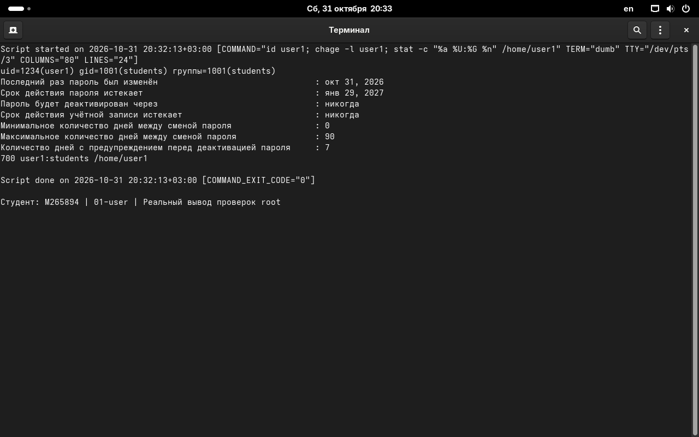
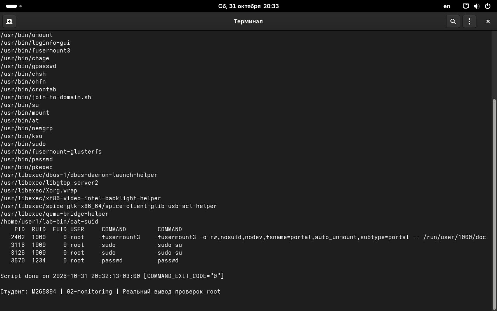
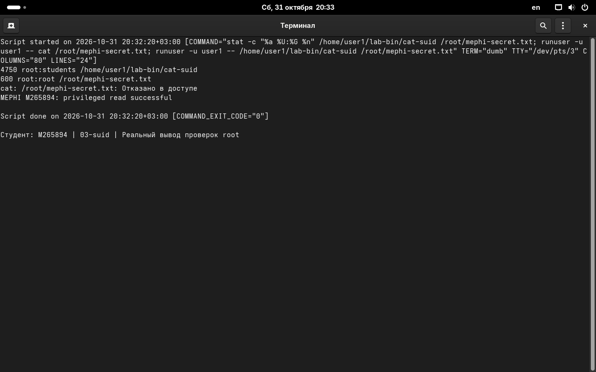
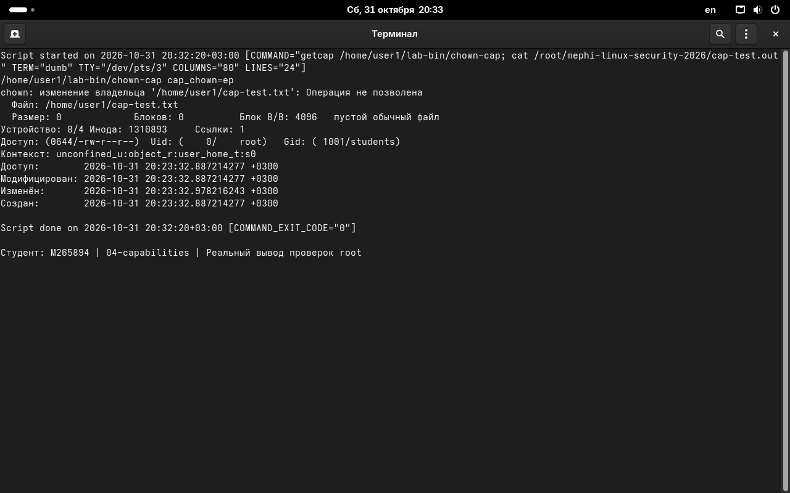
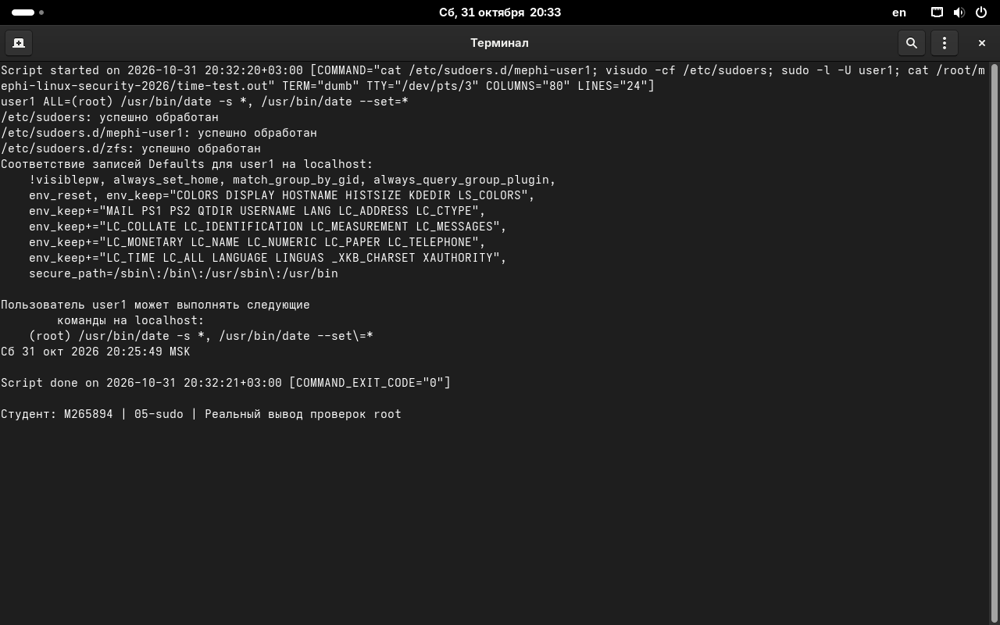

# Реальные скриншоты РЕД ОС

Сняты gnome-screenshot с рабочего стола виртуальной машины. В терминале отображён настоящий вывод проверок root, записанный script; для процессов, теста chown и установки времени показаны сохранённые результаты исходного выполнения. Изображения не рисовались и не редактировались.

## 01-user

## 02-monitoring

## 03-suid

## 04-capabilities

## 05-sudo

